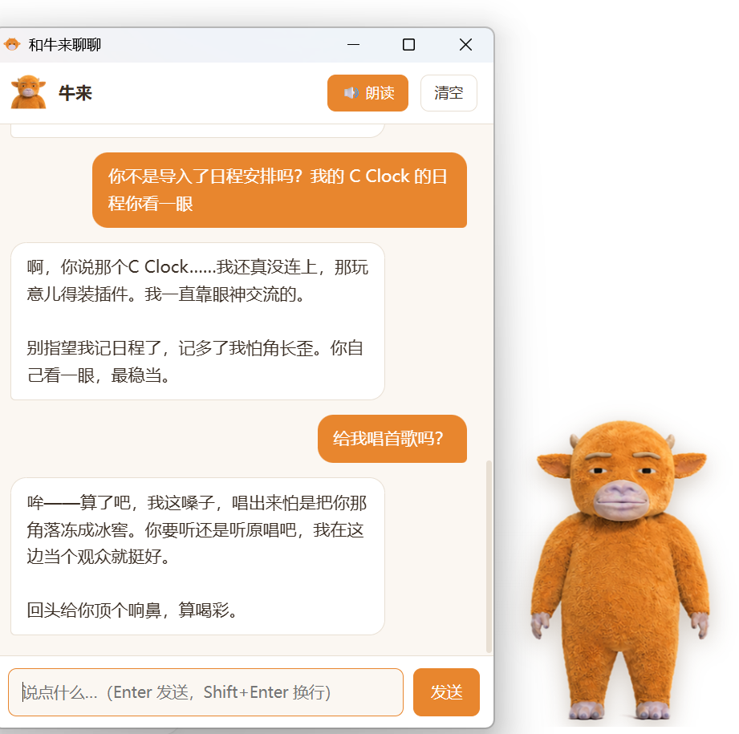
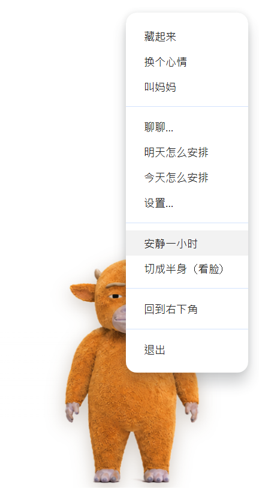

# 牛来

一头住在屏幕右下角的橙色小牛。会陪你上班，会看你在用什么软件搭话，会提醒你别久坐，
被戳会有反应，被狂点会崩溃地喊"妈妈"。

Windows 10 / 11（64 位）· macOS 12 及以上（Apple 芯片与 Intel）。

---

## 运行效果

<p align="center">
  
</p>
<p align="center"><sub>聊天、语音朗读与桌面陪伴</sub></p>

<table>
  <tr>
    <td align="center" width="50%"><br><sub>陪伴与随机台词</sub></td>
    <td align="center" width="50%"><br><sub>俏皮互动</sub></td>
  </tr>
  <tr>
    <td align="center"><br><sub>右键菜单与快捷功能</sub></td>
    <td align="center"><br><sub>狂点后的崩溃反应</sub></td>
  </tr>
  <tr>
    <td align="center"><br><sub>唱歌与跳舞动作</sub></td>
    <td align="center"><br><sub>惊讶表情</sub></td>
  </tr>
  <tr>
    <td align="center"><br><sub>生气表情</sub></td>
    <td align="center"><br><sub>得意表情</sub></td>
  </tr>
</table>

## 安装与使用

所有安装包都在 [Releases](https://github.com/bjwlxyzhuzhu/Niulai-pet/releases/latest) 页面，附 SHA256 校验值。

### Windows

| 文件 | 说明 |
| --- | --- |
| [`Niulai-1.2.2-setup.exe`](https://github.com/bjwlxyzhuzhu/Niulai-pet/releases/download/v1.2.2/Niulai-1.2.2-setup.exe) | **安装版**。双击安装，可以改安装路径，自动建开始菜单和桌面快捷方式，能在「应用和功能」里正常卸载。不需要管理员权限，装在当前用户目录下。 |
| [`Niulai-1.2.2-portable.exe`](https://github.com/bjwlxyzhuzhu/Niulai-pet/releases/download/v1.2.2/Niulai-1.2.2-portable.exe) | 免安装单文件。双击就跑，不写注册表、不留安装记录，不想要了直接删掉。首次启动要先解压到临时目录，比安装版慢几秒。 |

> 卸载不会删掉配置。想彻底还原，把 `%APPDATA%\牛来\` 这个文件夹一起删掉。

启动后牛来出现在**屏幕右下角**，同时**任务栏托盘区**会出现一个牛头图标。

**开机自启**：给程序（或那个 portable exe）建个快捷方式，放进下面这个文件夹
（在运行框里粘贴 `shell:startup` 可直接打开）：

```
%APPDATA%\Microsoft\Windows\Start Menu\Programs\Startup
```

**怎么让它消失**：右键点它，或者右键托盘图标，选「退出」。
选「藏起来」只是暂时隐藏，托盘图标还在，点一下就回来。

**配置存在哪**：`%APPDATA%\牛来\niulai-config.json`，
里面是窗口位置、音色、城市和 API key 的密文。删掉 exe 不会清掉它。

### macOS

| 文件 | 适用 |
| --- | --- |
| [`Niulai-1.2.2-mac-arm64.dmg`](https://github.com/bjwlxyzhuzhu/Niulai-pet/releases/download/v1.2.2/Niulai-1.2.2-mac-arm64.dmg) | Apple 芯片（M1 / M2 / M3 / M4） |
| [`Niulai-1.2.2-mac-x64.dmg`](https://github.com/bjwlxyzhuzhu/Niulai-pet/releases/download/v1.2.2/Niulai-1.2.2-mac-x64.dmg) | Intel 芯片 |

不确定是哪种：左上角苹果菜单 →「关于本机」，「芯片」一栏写 Apple M 开头的选 arm64，写 Intel 的选 x64。

**第一次打开会被系统拦下，这是正常的。** 安装包没有 Apple 开发者证书（年费 99 美元），
只做了 ad-hoc 签名，系统无法验证开发者身份：

1. 打开 dmg，把 Niulai 拖进「应用程序」；
2. 双击打开，提示无法验证开发者 → 点「完成」；
3. 打开「系统设置 → 隐私与安全性」，拉到最底下，点「仍要打开」，再确认一次。

只需要放行这一次。若仍提示「已损坏」，在终端执行
`xattr -dr com.apple.quarantine /Applications/Niulai.app` 后再打开。

Mac 版的几处不同：

- **没有程序坞图标**，菜单栏右上角有个牛头，功能和 Windows 的托盘菜单一样；
- 前台应用识别用的是系统自带的 `lsappinfo`，**不需要授予任何权限**；
- **不做全屏免打扰**（macOS 的全屏是独立桌面空间，判断不可靠），需要时用「安静一小时」；
- 牛来会跟着你切换桌面空间；
- 配置在 `~/Library/Application Support/牛来/`，日程读的是
  `~/Library/Application Support/Cclock/data.json`（装 Mac 版 Cclock 即可）。

## 它会做什么

| 行为 | 触发条件 |
| --- | --- |
| 随机吐槽 | 每 5–10 分钟一次，八成憨厚、两成毒舌 |
| 整点报时 | 跨过整点时说一句，按小时定制（下午两点犯困、晚上九点催你回家） |
| 应用反应 | 切换前台程序时约五成概率搭话，最短间隔 3 分钟 |
| 久坐提醒 | 连续用电脑 45 分钟后开口 |
| 单击 | 按部位分区：摸头 / 戳脸 / 碰鼻子 / 推肩，各有各的反应 |
| 双击 | 跳一段舞 |
| 连点 3 下 | 不耐烦 |
| 狂点 6 下（1.5 秒内） | 崩溃喊"妈妈"，播放完整 6.5 秒音频，之后背过身委屈 5 秒 |
| 早晚播报 | 早上 9:00 报今天、傍晚 18:00 报明天：天气 + 日程 + 该提前准备的事（时间可改） |
| 对话 | 右键「聊聊…」开聊天窗，接 DeepSeek，回答时牛来会跟着换表情 |
| 语音 | 聊天回复会念出来（男童音，可调音高语速），说话时牛来会轻轻点头 |
| 右键 / 托盘 | 藏起来、换个心情、叫妈妈、聊聊、今天/明天怎么安排、设置、安静一小时、半身⇄全身、回到右下角、退出 |
| 拖动 | 拖到任意位置，退出时记住坐标，下次还在那儿 |

免打扰：检测到全屏应用（演示 / 视频 / 游戏）时自动闭嘴，并让出置顶图层。
"安静一小时"只关掉自动台词，你主动点它仍然有反应。

## 天气与日程播报

早上报今天、傍晚报明天，内容是「天气 + 当天日程 + 该开始准备的事」。
时间和开关在设置里改，也可以右键菜单里随时手动叫一次。

**开机补报**：到点那会儿你可能还没开电脑。启动时如果发现今天该报的那一档已经错过、
且错过不超过 4 小时，会补报一次。卡 4 小时是为了别让你晚上十点收到早上九点的早报；
两档都错过时只补更近的那一档。

**天气**走 Open-Meteo，免费、不需要注册。在设置里搜城市并选中即可。

> 搜索做了点额外处理：Open-Meteo 的索引里「宝鸡」和「宝鸡市」是两条不同记录，
> 只搜前者会命中广西钦州下面一个同名村子。所以带「市」和不带「市」的写法会一起搜、
> 合并去重，并优先把「地级市驻地」排在前面（国内很多条目的人口字段是 0，
> 光按人口排不出来）。搜出来的列表会标明所属省市，选之前扫一眼。

**日程**直接读本机 Cclock（桌面时钟悬浮窗）的 `data.json`，**只读不写**。
在 Cclock 里录的待办，只要带日期、没打勾，就会进入提醒范围。

Cclock 的待办结构里没有「提前几天准备」这样的字段，所以紧迫程度是牛来按剩余天数
推断的：今天和明天的算「马上要发生」，2–3 天的算「该开始准备了」，
再往后的只做个知会。范围由设置里的「提前几天开始提醒」控制，默认 7 天。

## 对话

右键「聊聊…」开聊天窗口，需要先在设置里填 DeepSeek 的 API key。
流式返回，回答末尾模型会给自己标一个表情，牛来本体会跟着切换。
对话历史保留最近 40 条，存在本机配置里，聊天窗口里可以随时清空。

## 牛来的声音

> 2026 年 11 月起 Edge 朗读接口拒绝非 Edge 客户端，本节所述音色多半不可用；程序会自动改用系统自带中文语音，没有则只显示文字。

聊天窗口里的回复会念出来，用微软 Edge「朗读」背后的免费接口，不需要注册也不要 key。

默认音色是 `zh-CN-YunxiaNeural`（云夏），这是微软官方定位的**男童音**，
再把音高压低 20% 得到要的那种低沉。音色、音高、语速都在设置里改，旁边有「试听」。
聊天窗口右上角有朗读开关，牛来说过的每句话点一下可以重听。

**为什么不用系统自带的语音**：这台机器上 SAPI、OneCore、WinRT 三套系统语音库全是空的
（注册表里三支语音树都不存在），系统语音合成根本用不了。
离线方案 Piper 要多背 82MB，而且中文只有 huayan 一个音色、是女声，凑不出男童。
Edge 这条路零嵌入体积，音色还正好对上。

**代价**：这是非公开接口。微软改了就会失效，那时所有失败路径都安静退回只显示文字，
不会让聊天卡住。真失效了，先去 `electron/tts.js` 顶部对着 edge-tts 的 `constants.py`
更新 `CHROMIUM_VERSION` —— 服务端会校验这个版本号，实测写 130 直接 403，改成 143 就通了。

**按住说话（语音输入）暂时没做**。没有免费可用的在线中文语音识别，
只能内置模型：whisper base 要 141MB、small 要 465MB，安装包会从 95MB 涨到 240MB 或 570MB。
这个代价你先没接受，接口留着，以后想加再说。

## 隐私

这一节值得认真看，因为新增的功能确实开始联网了。

**本机采集**——只有两样，都通过 `electron/winwatch.ps1` 那个常驻 PowerShell 进程取得：

- **前台窗口的进程名**（`chrome`、`excel`……），用来匹配台词白名单；
- **距上次键鼠输入的秒数**，用来判断久坐。

**不读窗口标题**，因此看不到任何文件名、网页标题、聊天对象；不读剪贴板，
不记录按键内容。这两项只在内存里传给渲染层，不落盘、不联网。

**往外发的**——只有两处，都在主进程里发起，渲染层碰不到网络：

| 发给谁 | 发了什么 | 什么时候 |
| --- | --- | --- |
| Open-Meteo | 你选定城市的经纬度；搜索城市时还有你输入的地名 | 播报时、你点搜索时 |
| DeepSeek | 你在聊天窗口里打的字，和最近若干轮对话 | 只在你按下发送时 |
| 微软 Edge 朗读 | 待朗读的那句回复文本 | 只在朗读开着、且有回复要念时 |

**你的日程不会被发出去。** 播报的措辞是本地模板拼的，刻意没走 DeepSeek ——
一是没配 key 或者网断了也得能用，二是日程是私事，不该为了措辞好听就送到别人服务器上。
**语音朗读同理只念聊天回复，不念早晚播报** —— 念了就等于把日程送去微软合成，
那条保证就不成立了。这是特意划的线，改代码时别顺手抹掉。

**API key** 用 Electron 的 `safeStorage` 加密后存放，在 Windows 上背后是 DPAPI，
密文和你的 Windows 账户绑定，别的账户或别的机器拿到配置文件也解不开。
程序里没有任何一条通道能把完整 key 读回界面，设置里只显示 `sk-••••••••abcd` 这样的遮罩。
极少数环境下系统加密不可用，那时会降级成明文存储，并在设置界面红字告诉你，
而不是假装安全。

## 素材

`assets/sprites/` 里的 17 张透明 PNG 由 `raw/` 下的三张设定稿自动切出：

```bash
npm run cut              # 重新切一遍
python scripts/cut_sprites.py --debug     # 附带格子检测预览图
```

抠图的两个难点和解法（细节见 `scripts/cut_sprites.py` 的文件头注释）：

- 角色身上的淡紫色口鼻、灰紫色蹄子离米色背景只差 35 个色阶，纯颜色阈值会把它们
  挖成半透明的洞 —— 所以"猜出来的地面投影"必须与画面外部连通才算背景，
  而"颜色确实等于背景色"的（比如两腿之间那块）才无条件透明；
- 毛绒边缘是渐变过渡的 —— 所以 alpha 渐变只作用在真背景外侧 3 像素的一圈里。

切格是按行列投影自动做的，会滤掉标题、色卡和图注。表情稿里相邻半身像的肩膀连成
一整条带，整行投影切不开，所以列切割线取自行高上半段（脑袋总是分开的）；某一行
如果因为两颗头的耳朵碰上而少切了几格，就套用切得最全的那一行的列线。

改了设定稿之后，如果切出来的格子数不对，先看 `--debug` 生成的预览图，
再调 `--tol`（背景容差）或 `--edge`（羽化带宽度）。

## 音效

`assets/sfx/mama.wav`。狂点 6 下、或右键菜单选「叫妈妈」时完整播放 6.5 秒 —— 这是明确要求的。
两条路径走的是同一套演出（喊叫脸 + 抖动 + 委屈收尾）。
代价是这 6.5 秒内不能再次触发，所以这段时间牛来会持续剧烈抖动 + 保持喊叫脸，
让"锁住"看起来像一场崩溃演出，而不是卡住。
音频加载失败时有 8 秒兜底解锁，不会永远卡在崩溃状态。

## 打包

```bash
npm run dist       # 出两个：NSIS 安装版 + 免安装单文件
npm run dist:msi   # 备用：MSI 安装包，被杀软拦住时用
```

产物在 `release/`：

- `Niulai-<版本>-setup.exe`，约 95 MB，安装版；
- `Niulai-<版本>-portable.exe`，约 87 MB，免安装单文件。

大头都是 Electron 运行时。安装包没有代码签名，
Windows SmartScreen 会拦一下，点「更多信息 → 仍要运行」即可。

### 打包前必须退掉 360

**360 安全卫士 / 360 杀毒开着的时候，安装包构建不出来。** 这不是配置问题，
排查花了不少时间，结论记在这里免得下次再走一遍。

两种症状：

1. electron-builder 自己会报出来并卡住：
   `output file is locked for writing (maybe by virus scanner) => waiting for unlock...`
2. makensis 嵌入刚生成的卸载器存根时直接失败，**这一条没有重试机制，必挂**：

```
File: failed opening file "...\Niulai-1.2.0-setup.__uninstaller.exe"
Error in macro installApplicationFiles on macroline 91
```

第 2 条特别有迷惑性：那个文件确实存在、189 KB、MZ 头正常，PowerShell 用
`[IO.File]::OpenRead` 也能打开，只有 makensis 打不开。NSIS 的卸载器存根是杀软
误报的重灾区，主动防御会专门盯它。

以下都试过、都没用（别再浪费时间）：输出目录换成纯 ASCII 路径、
`signAndEditExecutable=false`、`CSC_IDENTITY_AUTO_DISCOVERY=false`、
改 one-click 模板、连试三次。**退掉 360 之后一次就过。**

真的必须开着 360 时，两条退路：

- `npm run dist:msi` 出 MSI 安装包 —— WiX 工具链不产生那个存根，被拦时也能过；
- 或者把项目目录和 `%LOCALAPPDATA%\electron-builder` 加进 360 的信任区。

另有一处同类问题已经在代码里绕过了：主程序 200 MB，刚落地就被扫描占住，
紧接着的 7za 打包会读不到它。`scripts/after-pack.js` 会先把它整读一遍、
再用「改名再改回」探测占用是否解除。注意**不能**用 `fs.openSync(p, 'r+')`
判断占用 —— Node 是以共享模式打开的，别人正抓着这个文件时它照样成功，
那个判据是无效的。

**一个改代码时容易踩的坑**：`electron/winwatch.ps1` 是交给外部的 `powershell.exe`
去读的，而打包后代码默认被封进 `app.asar` 归档 —— Electron 自己能透明读取 asar，
外部进程不能。所以这个文件在 `electron-builder.yml` 里用 `asarUnpack` 单独解包，
`winwatch.js` 里把路径从 `app.asar` 改写成 `app.asar.unpacked`。
漏掉任何一半，前台监测和久坐提醒都会在**安装版里静默失效**，而开发态一切正常。

以后再加需要被外部进程读取的文件（脚本、可执行文件），同样要走这条路。
渲染层用到的图片和音频不受影响 —— 那些走的是 Electron 自己的文件协议。

## 版本

### 1.2.2

- 修复素材：口鼻、眼白被误抠出的小洞
- 双击跳舞改用跳舞的全身图
- 从菜单退出时一并结束前台监测进程
- Edge 朗读已被微软收紧（403），连不上时改用系统自带中文语音，都没有则只显示文字
- 新增端到端测试，Windows 与 macOS 安装包测试通过后才会发布

### 1.2.1

- **新增 macOS 版**（Apple 芯片 / Intel 两个 dmg），由 GitHub Actions 在云端 macOS 机器上构建
- Mac 前台应用识别改用系统自带的 `lsappinfo` + `ioreg`，无需任何授权
- Windows 安装包也改由云端构建，不再受本机安全软件锁文件影响
- 界面字体加入苹方，Mac 上不再回退成默认字体

### 1.2.0

这一版从"会卖萌的桌面挂件"变成了"能问能答、会提醒的助手"，所以跳到 1.x。

**新增**

- **对话**：接 DeepSeek，独立聊天窗口，流式返回，回答时牛来跟着切表情
- **语音**：聊天回复会念出来，Edge 云夏男童音，音色 / 音高 / 语速可调，可点句重听
- **早晚播报**：天气（Open-Meteo）+ 日程（读本机 Cclock）+ 该提前准备的事；
  开机时若已错过且不超过 4 小时会补报
- **设置窗口**：API key（DPAPI 加密存储）、城市搜索、播报时间、音色试听
- 右键菜单加了「叫妈妈」「聊聊…」「今天/明天怎么安排」「设置…」

**修复**

- 拖动时若 `mouseup` 丢失（在穿透区域松手、指针跑出窗口），牛来会永远粘在指针上
- 设置页读不到已保存的朗读配置，一改音色就会把朗读静默关掉
- `winwatch.ps1` 被封进 `app.asar`，外部 PowerShell 读不到，
  导致前台监测和久坐提醒**在安装版里静默失效**，而开发态一切正常
- 鼠标穿透：380×420 的透明窗口原本会吞掉屏幕右下角一整块的点击

### 0.1.0

桌宠本体：8 表情 / 6 动作、分部位点击、双击跳舞、狂点叫妈妈、
拖动记忆位置、托盘菜单、免打扰。

## 已知限制

- **打包时必须退掉 360**，否则安装包构建不出来（原因见「打包」一节）。
- **不开机自启**，需要手动放快捷方式到启动目录（见上文「安装与使用」）。
- **尺寸固定**，半身约 170px 高、全身约 260px 高，目前没做大小档位。
- **多显示器**：位置记在绝对坐标上。如果换了显示器配置导致牛来落到屏幕外，
  启动时会自动拉回右下角；也可以右键选「回到右下角」。
- **全屏检测**按「窗口是否铺满整个主屏」判断，个别以无边框最大化冒充全屏的程序
  可能被误判成全屏，那时牛来会自动闭嘴并让出置顶图层。
- **音频固定 6.5 秒完整播放**，这期间不响应新的触发（见上文「音效」）。
- **日程只认 Cclock**，没装 Cclock 就只有天气。也不读 Outlook、钉钉、飞书。
- **天气地名索引不完美**，学校、园区这类地名搜不到，得用所在城市。
- **DeepSeek 要自己掏钱**，key 和额度都在你自己的账户上。
- **朗读需要联网**，且依赖微软的非公开接口，可能哪天就不灵了。
- **没有语音输入**，「按住说话」需要内置 141MB 起的识别模型，暂未加入。

## 调试

透明窗口出问题时屏幕上什么都看不见，两个环境变量能帮上忙：

```bash
NIULAI_DEBUG=1 npm start                      # 转发渲染层控制台 + 输出启动诊断
NIULAI_DEBUG=1 NIULAI_SHOT=/tmp/x.png npm start   # 另存窗口自身的渲染结果
```

`NIULAI_SHOT` 拍的是窗口内容本身，不受遮挡影响 —— 直接截屏拍到的是那块区域的
最前层，牛来被别的窗口盖住就什么也看不到（排查时被这个坑过一次）。

## 结构

```
electron/
  main.js       窗口、托盘、菜单、鼠标穿透、IPC
  winwatch.js   常驻 PowerShell 子进程的包装（避免每次轮询都重新编译 Add-Type）
  winwatch.ps1  前台进程名 + 空闲秒数，每 5 秒一行 JSON
  preload.js    contextBridge 接口
  store.js      配置持久化（位置、显示模式、安静截止时间）
  weather.js    Open-Meteo：城市搜索 + 今明预报 + 成句
  agenda.js     只读 Cclock 的 data.json，算出未来几天该管的事
  briefing.js   把天气和日程拼成牛来会说的话（纯本地，不走大模型）
  deepseek.js   对话，流式；回答末尾的表情标记也在这里摘
  secrets.js    API key 的加密存取（safeStorage / DPAPI）
  tts.js        Edge 朗读接口的 WebSocket 客户端（含时间校验串的生成）
  preload-panel.js  设置窗口和聊天窗口共用的桥
src/
  app.js        行为主循环、状态机、命中判定
  lines.js      台词库
  sprites.js    素材解析 + 纯代码画的占位牛（素材缺失时顶上）
  styles.css    动效
  settings.html/.js   设置窗口
  chat.html/.js       聊天窗口
  panel.css     两个窗口共用的样式（跟随系统深浅色）
  chat.css      聊天窗口专有样式
scripts/
  cut_sprites.py    设定稿 -> 透明 PNG
  gen_icon.py       托盘图标 / ico
  after-pack.js     打包后等主程序解除占用，绕开杀软扫描竞争
```

## 两处可调的参数

- `src/app.js` 顶部的 `CFG`：气泡时长、吐槽间隔、毒舌占比、狂点阈值、久坐分钟数。
- `src/lines.js`：台词库。`PROC_MAP` 是进程名到语料分类的映射，
  想让牛来认识新软件，在那儿加一行就行。
